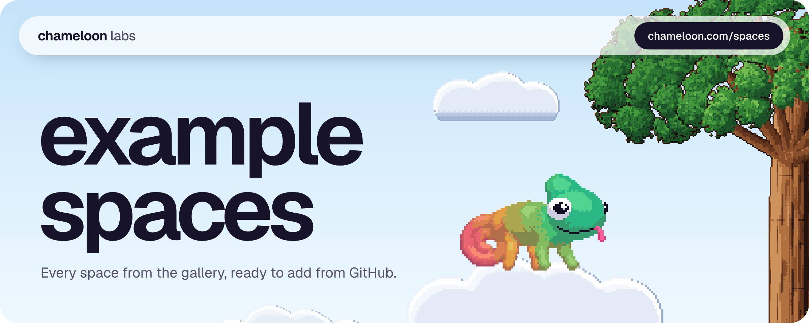
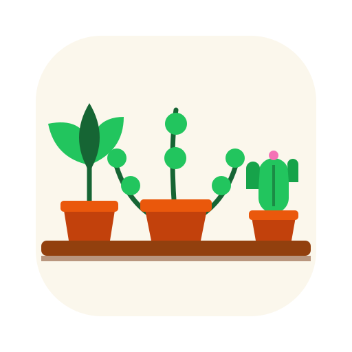
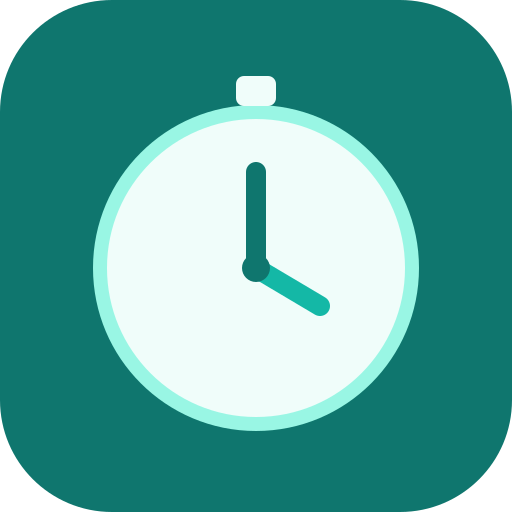
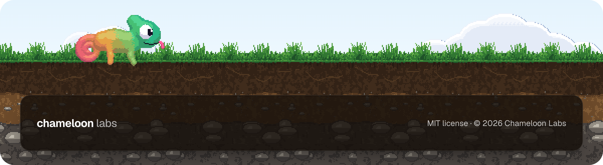

<a href="https://chameloon.com/spaces/"></a>

<p align="center">
  <a href="https://chameloon.com/spaces/"></a>
  <a href="https://chameloon.com/docs/"></a>
</p>

Every space from the [Chameloon gallery](https://chameloon.com/spaces/), one folder each. A space is a `space.json` and a few
pages in OpenUI Lang. It runs on your iPhone, offline: its data stays in its own database there.

## Add one to your phone

In Chameloon, tap **+** and paste this repository's address, `github.com/Chameloon-Labs/spaces`. The app
lists the spaces in it; pick one. To add one space directly, paste its folder's address, for example
`github.com/Chameloon-Labs/spaces/tree/main/habits`.

The app shows where a space comes from and what it may use before anything is installed. When a space here gets a new
`version`, the app offers the update. Adding from GitHub needs Chameloon 1.2 or later; with an older version, add
them from the [gallery](https://chameloon.com/spaces/).

## The spaces

| Space | What it does | Links |
|---|---|---|
|  [**Bike log**](bikes/) | Every ride on every bike: this week's km, planned rides to tick off, and when each bike is due for service. | [bikes](bikes/) · [on chameloon.com](https://chameloon.com/spaces/bikes/) |
|  [**Budget**](budget/) | What you spend this month, by category, against your own budget. Never leaves this phone. | [budget](budget/) · [on chameloon.com](https://chameloon.com/spaces/budget/) |
|  [**Focus**](focus/) | Start a focus block, put the phone down, and get a nudge when it ends. Sessions and streak stay on this phone. | [focus](focus/) · [on chameloon.com](https://chameloon.com/spaces/focus/) |
|  [**Habits**](habits/) | Small daily habits, ticked off in a tap. Streaks and reminders stay on this phone. | [habits](habits/) · [on chameloon.com](https://chameloon.com/spaces/habits/) |
|  [**Plant Panic**](jungle/) | Plant rescue for a very chaotic household: who is thirsty, how healthy everyone is, and plant number 5 must survive. | [jungle](jungle/) · [on chameloon.com](https://chameloon.com/spaces/jungle/) |
|  [**My Day**](myday/) | One calm plan for the whole day: morning routine, the market list, today's spending and tonight's garden party. | [myday](myday/) · [on chameloon.com](https://chameloon.com/spaces/myday/) |
| [**Parked**](parked/) | Where did I park? One tap saves the spot, Maps takes you back. Never leaves this phone. | [parked](parked/) · [on chameloon.com](https://chameloon.com/spaces/parked/) |
|  [**Pet care**](petcare/) | Meals, medicine and vet dates for every pet. One tap when you fed them, a reminder when something is due. | [petcare](petcare/) · [on chameloon.com](https://chameloon.com/spaces/petcare/) |
|  [**Plants**](plants/) | Who needs water today. A photo of each plant and a nudge when it's thirsty. | [plants](plants/) · [on chameloon.com](https://chameloon.com/spaces/plants/) |
|  [**30-Day Push-ups**](pushups/) | A 30-day push-up challenge with friends: log reps with one big button, keep the streak, watch the leaderboard. | [pushups](pushups/) · [on chameloon.com](https://chameloon.com/spaces/pushups/) |
|  [**Showcase**](showcase/) | Every component a space can draw and every phone feature it can ask for, on real data. | [showcase](showcase/) · [on chameloon.com](https://chameloon.com/spaces/showcase/) |
|  [**Subscriptions**](subscriptions/) | Every subscription on one page: what it costs a month and a year, what renews next, and a reminder before it does. | [subscriptions](subscriptions/) · [on chameloon.com](https://chameloon.com/spaces/subscriptions/) |
|  [**Team Day**](teamday/) | Who is in, remote or out sick today, with their excuses, and the 3 pm cake party. | [teamday](teamday/) · [on chameloon.com](https://chameloon.com/spaces/teamday/) |
|  [**Time clock**](timeclock/) | Start work, break, business trip and end of day: one tap from the Lock Screen or Shortcuts. | [timeclock](timeclock/) · [on chameloon.com](https://chameloon.com/spaces/timeclock/) |
|  [**Warranty locker**](warranty/) | Receipts and warranty dates in one place. A reminder before a warranty ends, so you still have time to claim. | [warranty](warranty/) · [on chameloon.com](https://chameloon.com/spaces/warranty/) |
|  [**Water**](water/) | Tap a glass, fill the ring. A week chart and gentle reminders through the day, all on this phone. | [water](water/) · [on chameloon.com](https://chameloon.com/spaces/water/) |

## Make your own

Copy a folder, change `space.json` and the pages, and check it:

```sh
bunx --package @chameloon-labs/space chameloon-check ./my-space
```

Put it in a public GitHub repository of your own, and anyone can add it the same way. How spaces work, every
component and the format: [chameloon.com/docs](https://chameloon.com/docs/).

## License

MIT, see [LICENSE](LICENSE). Copy any of these and make it yours.

<br />

